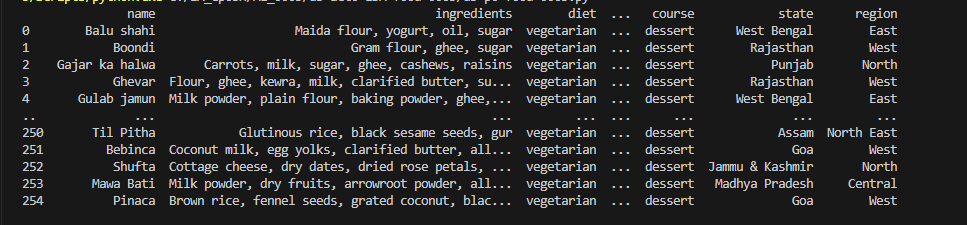
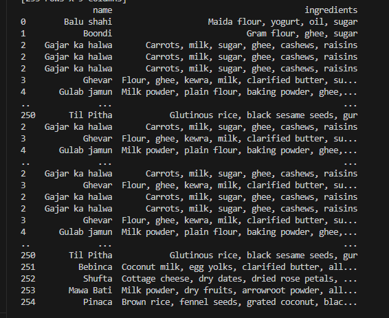
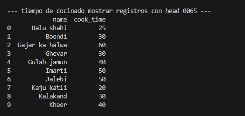
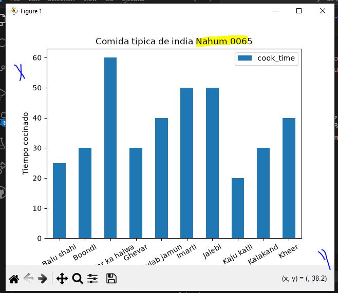
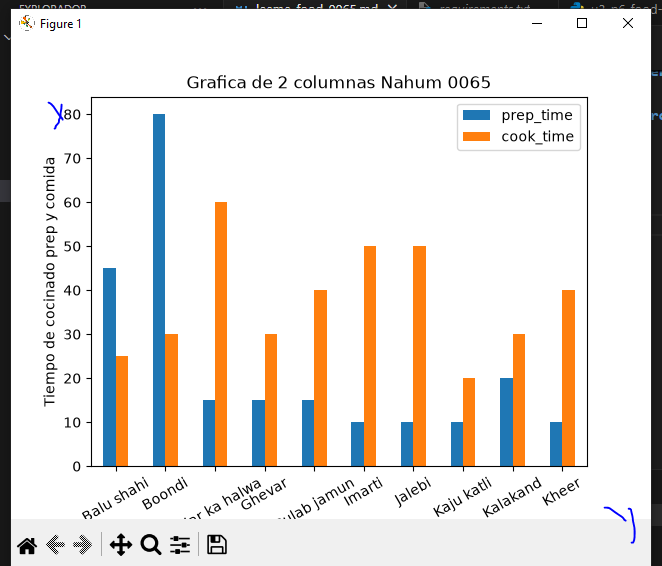
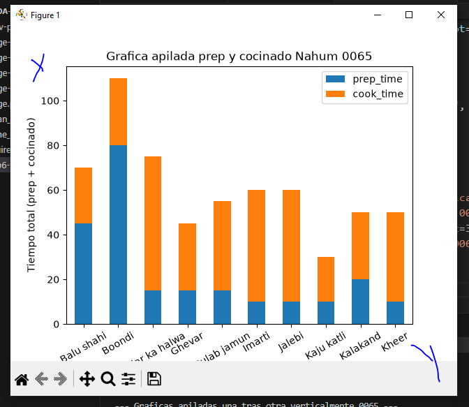

## Analisis exploratorio de datos
## Comida del pais India
## Nahum flores 0065
### -+-+- importando datos del archivo csv comida india 0065

### -+-+ Mostrar nombre comida + ingredientes 0065

### Tiempo de cocinado mostrar 10 registros con head 0065

## Creacion de graficas de barras 0065

## Creacion grafica de 2 columnas

## Graficas apiladas
